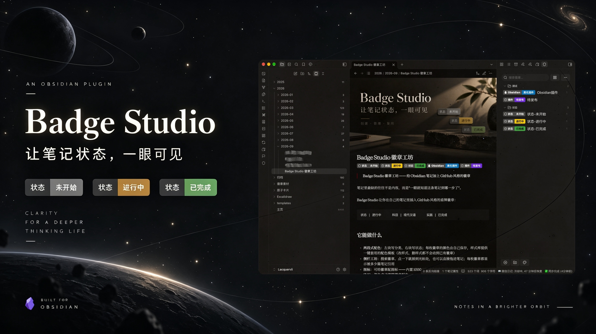

<p align="center">
  
</p>

<h1 align="center">Badge Studio 徽章工坊</h1>

<p align="center">给 Obsidian 笔记加上 GitHub 风格的盾牌徽章——像标签一样自由定义，像图标一样醒目好认。</p>

---

想在笔记里加上 GitHub 风格的盾牌徽章？Badge Studio 让你自由定义：左段写什么、右段写什么、用什么颜色、加什么图标，全由你决定。可以当成分类标签、状态标记、优先级提示，也可以只当作让笔记更好看的视觉装饰。徽章数据保存在本地，还能一键固化成真正的 SVG 图片，换设备、发给别人、甚至卸载插件都不会丢失。

## 它能做什么

- **两段式配色**：左块写分类、右块写状态，颜色由徽章自己保存；样式库提供一键套用的配色模板（改样式、删样式都不会动到已有徽章）
- **侧栏徽章工坊**：列表 / 堆放两种视图，可搜索、可右键、可拖进笔记
- **图标**：内置 1000+ 个（填个名字就行），也能粘贴自己的 SVG；两个胶囊的左右两侧各能放一枚
- **可点击**：徽章能挂链接，点击直接跳到对应笔记或外部网址
- **可固化**：一键把徽章"焊"成真正的 SVG 图片 —— 换设备、发给别人、甚至卸载插件，徽章都还在
- **导入导出 JSON**：换库、换电脑直接搬走
- 删除徽章时，会顺手清掉全库笔记里的标记行与已固化的图片

## 安装

**方式一：手动**

1. 到 [Releases](../../releases) 下载 `main.js`、`manifest.json`、`styles.css`
2. 放进 `你的库/.obsidian/plugins/badge-studio/`
3. 在 Obsidian 设置 → 第三方插件里启用「Badge Studio 徽章工坊」

**方式二：BRAT**

安装 [BRAT](https://github.com/TfTHacker/obsidian42-brat) 插件后，运行命令 `BRAT: Add a beta plugin for testing`，填入下面这个地址即可：

```
https://github.com/Lacquervii/badge-studio
```

## 用法

1. 点左侧栏的盾牌图标打开「徽章工坊」，新建徽章（起名字、写左右文字、选配色、加图标）
2. 在笔记里空行处点一下侧栏里的徽章 → 插入，或写一行 `badge: 名字`
   - 编辑模式和阅读模式都会把它渲染成徽章
   - 光标落在标记行上时会显示原文，方便修改
3. 想把徽章变成本地图片，运行命令「固化本篇徽章为图片（耐用形态）」；想改回去就运行「还原本篇徽章为标记」

## 开发

```bash
npm install
npm run dev        # 监听构建
npm run build      # 生产构建（输出 main.js）
npm run typecheck  # 类型检查
npm test           # 单元测试
```

## License

[MIT](LICENSE) © Lacquervii
